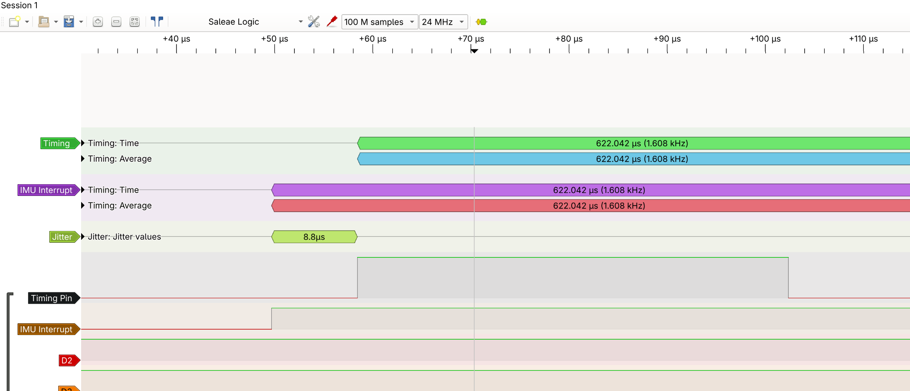

# STM32 Flight Controller

Quadrotor flight controller firmware on an STM32F446 (Cortex-M4F, 180 MHz) running FreeRTOS, with an LSM6DSOX IMU over SPI. Built as a measurement-driven project: requirements written first, every timing claim backed by a logic-analyzer capture.

**Status (Oct 2026):** IMU pipeline and control-loop timing complete and verified. Motors, PID tuning and hardware-in-the-loop (HIL) testing are next.

## Results

| Measurement | Result | Evidence |
|---|---|---|
| Control loop rate | 1.608 kHz, locked to IMU data-ready, no dropped cycles | [loop timing](docs/captures/loop_timing_after_wide.png) |
| Data-ready → task latency | 8.3–9.3 µs (REQ-01 limit: 50 µs jitter) | [latency capture](docs/captures/drdy_latency.png) |
| Loop execution time | ≈ 44 µs (≈ 7 % of the 622 µs period) | same capture |
| Static angle noise | 0.127° RMS accel-only → 0.015° RMS filtered (8.3×) | [plot](docs/data/tilt_20261023_170326.png), `tools/rms.py` |
| Host unit tests | 26 tests, `make test`, `-Werror` | `tests/` |



## Architecture

```
LSM6DSOX --SPI2 (5.6 MHz, mode 3)--> STM32F446
   INT1 (data-ready, pulsed) --> PC7 EXTI --> thread flag
                                              |
               control task (Normal prio) <---+
                 read 12 bytes -> convert -> complementary filter
                 -> queue (1 in 166 samples)
                                              |
               telemetry task (Low prio) <----+
                 snprintf -> UART (115200) -> tools/log_and_plot.py
```

- **`core/`**: portable C (PID, complementary filter, IMU conversion). The same files compile for the PC (unit tests) and the STM32.
- **`firmware/`**: STM32CubeIDE project; two-layer IMU driver (bus layer for I²C or SPI, shared device layer).
- **`tools/`**: serial logger/plotter and RMS noise script.
- **`docs/`**: [requirements](docs/requirements.md), [datasheet notes](docs/lsm6dsox-notes.md), captures and data.

## Debugging notes

**Logging stall dropped IMU samples.** The logic analyzer showed the control loop missing about 5 samples every ~105 ms. The period matched the telemetry rate: newlib's `printf` held a lock (critical section) for the whole 3.5 ms UART send, so the higher-priority control task couldn't run. Fixed by formatting with `snprintf` and sending with `HAL_UART_Transmit` outside the lock. [Before](docs/captures/logging_stall_before.png) / [after](docs/captures/loop_timing_after_wide.png).

**1.7° filter offset at rest.** Predicted from the size of the bias × the filter time constant (3.6 deg/s × 0.47 s ≈ 1.7°) and matched to within 0.1°. Cause: gyro bias calibration ran before the sensor had settled after power-on. Fixed with a settle delay and discarded samples, plus a calibration-spread printout.

**IMU rate 3.5 % slow.** Designed for the nominal 1.66 kHz but measured 1.608 kHz. The chip's factory trim register `INTERNAL_FREQ_FINE` read −24 ( -24 * 0.15% = −3.60 %), agreeing with the measurement within one step, so the filter's time step is now derived from that register at boot.

## Build and test

```bash
make test        # host unit tests (gcc)
```
Firmware: open `firmware/fc_firmware` in STM32CubeIDE 2.2, build, flash via the on-board ST-LINK.

## Hardware

NUCLEO-F446RE · Adafruit LSM6DSOX breakout (SPI2: PB13 SCK, PB14 MISO, PB15 MOSI, PB12 CS; INT1 → PC7) · PB10 = loop-timing pin for the logic analyzer.

## Roadmap

- [x] Requirements v0, portable control library + host tests
- [x] IMU bring-up (I²C, then SPI), bias calibration
- [x] Interrupt-driven loop, timing verified (REQ-01)
- [ ] Python plant model + HIL test harness (REQ-02, REQ-06)
- [ ] Watchdog and failsafes (REQ-03 to 05)
- [ ] ESC/motor output (DShot), thrust rig, PID tuning